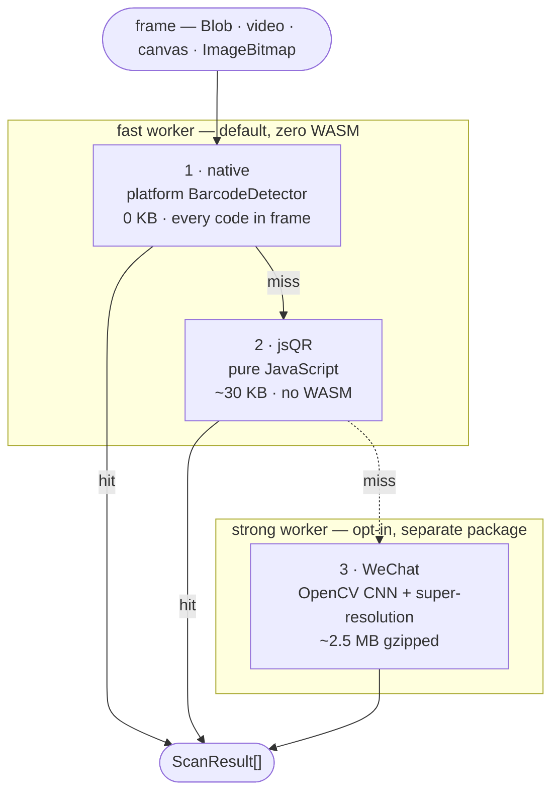

# QRCode Decode Ultra

[](https://github.com/zoexx/qrcode-decode-ultra/actions/workflows/ci.yml)
[](LICENSE)

A browser **QR scanner** that decodes clean codes at jsQR speed with **zero
WASM**, runs **off the main thread**, and escalates to an **opt-in OpenCV WeChat
super-resolution tier** only for the codes the fast path misses.


<sup>**Race mode** (opt-in) — the same frame goes to both workers at once and the
first real decode wins, so you can see which tier gets there first on your own
hardware. It is a measuring tool, not the default: normally the tiers *cascade*,
and the WeChat worker never wakes for a code `jsqr` already read.</sup>

```bash
npm i qrcode-decode-ultra              # core — zero WASM, framework-agnostic
npm i qrcode-decode-ultra-react        # optional: useScanner() + <Scanner/>
npm i qrcode-decode-ultra-wechat       # optional: the 2.5 MB strong tier
```

## The problem

Browser QR scanning makes you pick one:

- **Fast and tiny, but brittle.** jsQR is ~30 KB of pure JS and reads a clean,
  well-lit code instantly. It misses the codes people actually photograph —
  small, far away, motion-blurred, badly lit.
- **Accurate, but heavy for everyone.** The engines that *do* read those codes
  are megabytes of WASM, downloaded by every user on every visit — including the
  majority scanning a crisp code at arm's length.
- **Blocking.** Most scanners run the decode loop on the main thread, so the UI
  stutters while the camera is live.
- **One code per frame.** A sheet of labels or a wall of tickets becomes one
  scan per code.

You can't pick correctly up front, because which tier a frame *needs* is only
knowable after the cheap one has failed. So don't pick — cascade.

## How it works

Engines run in a fixed order and the **first one to decode anything wins**: its
results return immediately and no later tier is consulted. Cost climbs at each
step, so the common case never pays for the hard case.



- **The default install is zero-WASM.** `native + jsQR` only. The WeChat tier
  lives in a package you install separately, so its payload is never in a default
  bundle.
- **Nothing heavy touches the main thread by default.** The two tiers run in two
  workers. Measured in headless Chromium on an escalated decode: on the main
  thread it blocks for a ~290 ms task and drops 17 animation frames; in workers,
  no long task at all and zero frames dropped. The main thread only rasterizes
  the frame and routes it. (`worker: false`, or an environment without
  `Worker`/`OffscreenCanvas`, falls back to in-process — see
  [`DESIGN.md`](DESIGN.md).)
- **Native is probed, not trusted.** `'BarcodeDetector' in self` isn't enough:
  the constructor can exist while `detect()` silently returns `[]`, and an
  unrelated ponyfill can shadow it. So the engine runs a live decode of a
  baked-in synthetic QR and checks for `[native code]` before it's allowed to
  win. Where it is real (Android Chrome, Chromium on macOS/ChromeOS) it is both
  the strongest and the cheapest tier — Chromium's macOS backend calls Apple's
  Vision framework, Android's rides ML Kit.
- **The escalation warms itself.** A live frame whose smaller dimension drops
  below `lowResPreloadPx` (default 480) kicks off the WeChat load in the
  background, so the 2.5 MB is already resident on the frame that finally needs
  it instead of stalling on a cold download.
- **Backpressure, not a queue.** One in-flight decode at a time; a frame arriving
  mid-decode is dropped rather than queued, so the scanner never works on stale
  video.
- **Or race the two workers instead.** `race: true` sends each frame to both
  workers at once and takes the first real decode, so a hard code costs the
  *fastest* tier's time rather than the sum of the tiers ahead of it. Opt-in,
  because it spends a ~250 ms WeChat decode on every frame instead of only the
  missed ones. `onRace` reports both lanes' times per frame — which is how you
  find out which tier actually wins on a given device.

For the transport split, worker protocol, and `Engine` contract, see
[`DESIGN.md`](DESIGN.md).

## Quick start

```ts
import { createScanner } from "qrcode-decode-ultra";

const scanner = createScanner();

// Still image — every code the winning engine found in the frame.
const results = await scanner.scanImage(fileOrBlob);
for (const r of results) console.log(r.value, "via", r.engine);
```

Live camera — `onResult` is the primary code, `onResults` is all of them:

```ts
const controller = scanner.scanVideo(videoEl, {
  onResult: (r) => console.log("primary:", r.value),
  onResults: (rs) => console.log(`${rs.length} code(s) this frame`),
});
await controller.start();
```

React:

```tsx
import { Scanner } from "qrcode-decode-ultra-react";

<Scanner facingMode="environment" onResult={(r) => console.log(r.value)} />;
```

Full API: [`packages/core/README.md`](packages/core/README.md).

## Scope

**QR only.** No 1D barcodes, no DataMatrix / Aztec / PDF417. That focus is what
makes the two-tier design tractable; if you need general barcodes, use a
ZXing-based library.

**Codes per frame** depends on which tier won, because tiers are never unioned:

| Tier | Default | With `maxCodesPerFrame` set |
|------|---------|------------------------------|
| `native` | **every** code, one pass | unchanged — already free |
| `jsqr` | one | overlapping tiles — fixed cost, ~2.1s for ten codes |
| `wechat` | one | mask-and-rescan — one pass per code, ~2.6s for ten |

Multi-code is free on `native` and costs extra passes everywhere else, so it is
opt-in and defaults to off. It is a still-image feature: at those costs, live
video would drop to a couple of frames a second. Treat `onResults` as
"everything the winning engine saw", not a completeness guarantee.

## Packages

| Package | What |
|---------|------|
| [`qrcode-decode-ultra`](packages/core) | Framework-agnostic scanner: cascade, worker, still-image + camera APIs. Zero WASM. |
| [`qrcode-decode-ultra-react`](packages/react) | `useScanner()` hook + `<Scanner/>` component. SSR-safe, owns the camera. |
| [`qrcode-decode-ultra-wechat`](packages/wechat) | Opt-in OpenCV WeChat tier for low-res / hard codes. Installed separately. |

## Benchmark

Every engine receives the *same* `ImageData`, decoded once, and a wrong decode
counts as a **false positive, not a benign miss** — so detection rate can't be
farmed with garbage. Reproduce with `pnpm build && pnpm benchmark` (the harness
imports the built package): it regenerates the fixtures, re-runs, and rewrites the
table below.

<!--BENCH-->

_Benchmark: 5 images per category, Node runner (Darwin 25.5.0/x64, node v24.17.0), generated 2026-07-31T03:40:17.923Z._

**Detection rate by category** (higher is better):

| Engine | clean | rotated | blur | low_light | inverted | downscale_32 | damaged | torture | Overall |
|---|---|---|---|---|---|---|---|---|---|
| qrcode-decode-ultra-fast | 100% | 100% | 100% | 100% | 100% | 0% | 80% | 40% | 78% |
| qrcode-decode-ultra-max | 100% | 100% | 100% | 100% | 100% | 60% | 100% | 80% | 93% |
| jsqr | 100% | 100% | 100% | 100% | 100% | 0% | 80% | 40% | 78% |
| native | n/a | n/a | n/a | n/a | n/a | n/a | n/a | n/a | n/a |

**Speed & cold start**:

| Engine | cold-start (ms) | median decode (ms) | overall detection |
|---|---|---|---|
| qrcode-decode-ultra-fast | 1 | 8.5 | 78% |
| qrcode-decode-ultra-max | 747 | 14.8 | 93% |
| jsqr | 0 | 10.7 | 78% |
| native | n/a | n/a | n/a — no platform BarcodeDetector in Node — native needs a real browser |

> Native `BarcodeDetector` is reported `n/a` here because there is no platform backend off-browser; it is not a loss. The honest comparison the cascade lives in is the WASM/JS one above. The WeChat tier's value is its per-category win on hard codes (blur / low-light / downscale / torture) weighed against its cold-start cost.

<!--/BENCH-->

Read the per-category row, not the aggregate. The zero-WASM fast path already
saturates the ordinary categories — clean, rotated, blurred, low-light, inverted.
What the 2.5 MB actually buys is the hard columns (`downscale_32`, `damaged`,
`torture`), weighed against the cold-start figure sitting right beside them. That
pairing is the honest answer to "is the WeChat tier worth it, and for which
codes".

### In a real browser

The Node runner above cannot see two things: whether the platform
`BarcodeDetector` actually works, and what a decode costs the *main thread*.
Both need a browser, so there is a second harness —
`pnpm build && pnpm benchmark:browser` (Playwright + headless Chromium).

Workers do not make decoding faster; the transport adds a transfer and a round
trip. What they buy is main-thread availability, so blocking is the metric.

<!--BENCH-BROWSER-->

_Browser benchmark: chromium 151.0.7922.34, Darwin 25.5.0/x64, generated 2026-07-31T02:44:07.523Z._

**Main-thread cost of an escalated decode** — a `downscale_32` fixture, the case the fast path genuinely cannot read, so the WeChat tier runs. Figures span 5 consecutive decodes with the model already loaded.

| Transport | longest task | total blocking | longest frame gap | frames dropped |
|---|---|---|---|---|
| main thread (worker: false) | 288 ms | 516 ms | 299 ms | 17 |
| workers (default) | 0.0 ms | 0.0 ms | 17.8 ms | 0 |

> A task over 50ms is what the browser itself calls blocking; over ~100ms a tap feels unresponsive. `frames dropped` is what a 60fps camera preview loses.

**Per-frame cost at 720p** — a clean code in a 1280x720 frame read by the fast path, no escalation. The gap between the two rows is what the worker transport costs: one bitmap transfer plus a round trip. Absolute wall-clock is inflated by headless software rasterisation, so read the difference, not the magnitude.

| Transport | per frame | longest task | frames dropped |
|---|---|---|---|
| main thread (worker: false) | 146 ms | 0.0 ms | 0 |
| workers (default) | 167 ms | 0.0 ms | 0 |

**Native `BarcodeDetector` on this platform**: available

**Detection rate by category, in-browser** (the `fast` row now includes native):

| Preset | clean | rotated | blur | low_light | inverted | downscale_32 | damaged | torture | Overall |
|---|---|---|---|---|---|---|---|---|---|
| fast | 100% | 100% | 100% | 100% | 100% | 0% | 100% | 40% | 80% |
| max-accuracy | 100% | 100% | 100% | 100% | 100% | 60% | 100% | 80% | 93% |

> Engines that won at least one frame here: native, wechat.

<!--/BENCH-BROWSER-->

## Development

```bash
pnpm install
pnpm build       # build all packages via tsup
pnpm test        # vitest
pnpm typecheck   # tsc --noEmit across the workspace
pnpm demo        # Vite dev server: webcam + still image
pnpm benchmark   # regenerate fixtures, run, rewrite the table above
```

There is no linter or formatter — `pnpm typecheck` and `pnpm test` are the gates,
and CI runs both.

## License

MIT for QRCode Decode Ultra's own code. The engines it builds on — jsQR, and the
OpenCV WeChat model behind `qrcode-decode-ultra-wechat` — are Apache-2.0 and
remain so; their notices are preserved, not relicensed. See [`NOTICE`](NOTICE)
and [`THIRD-PARTY-LICENSES.md`](THIRD-PARTY-LICENSES.md).
